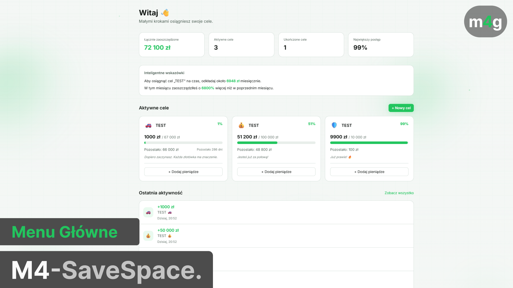
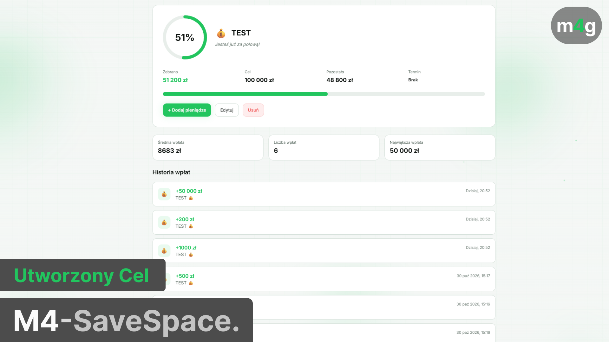
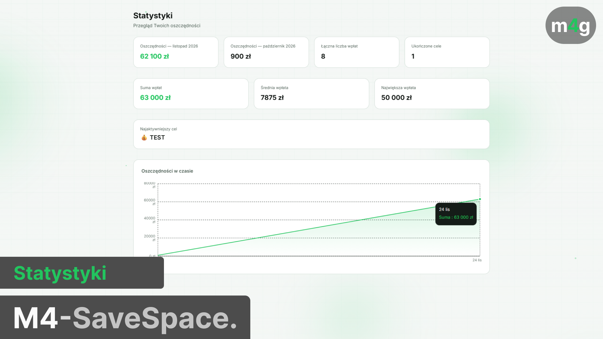
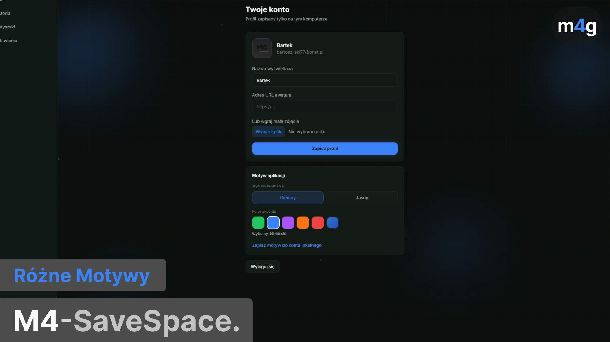
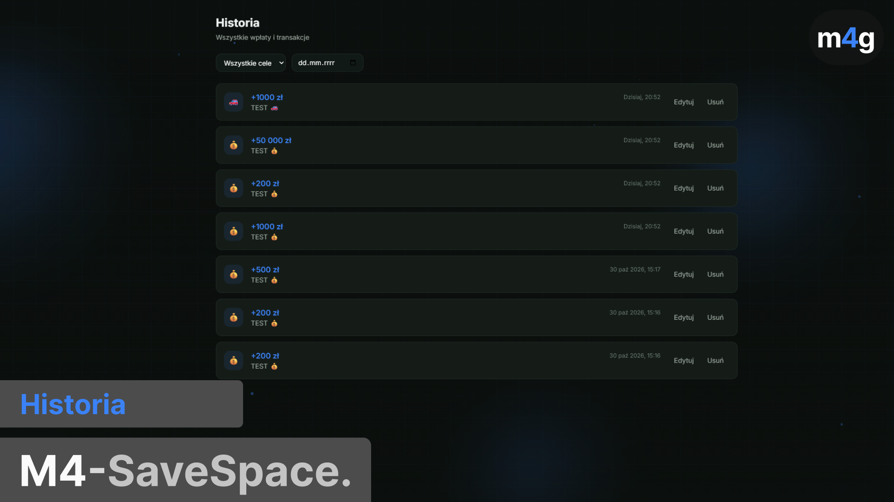
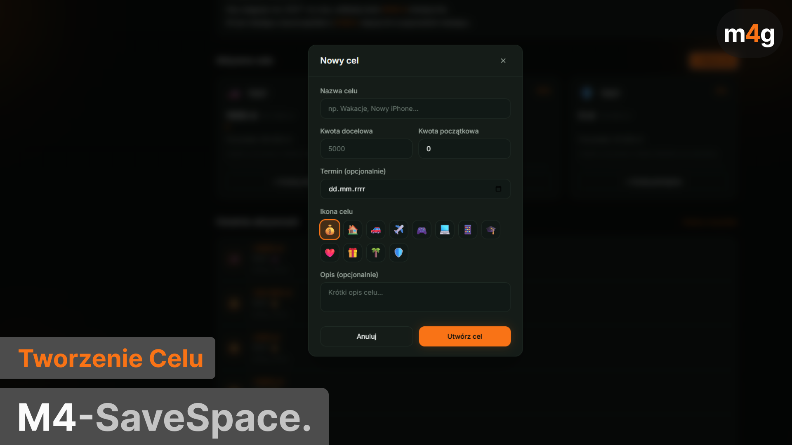
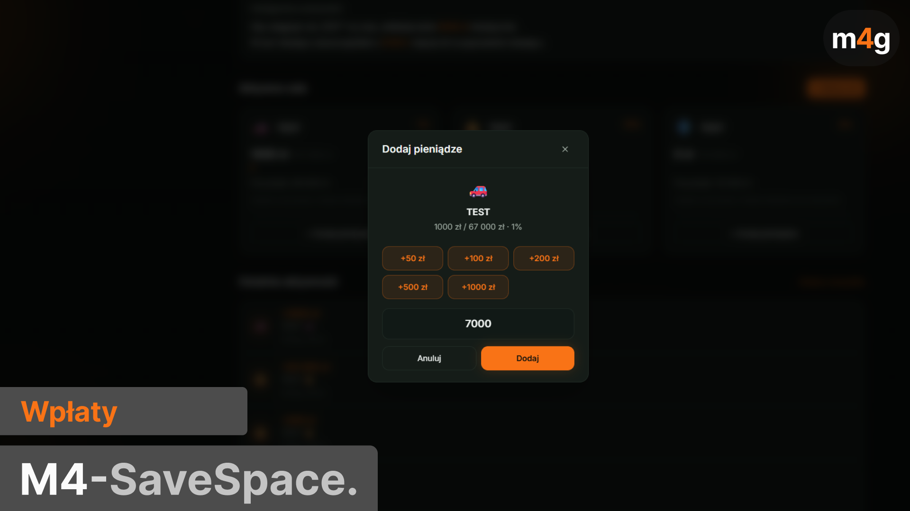

## M4-SaveSpace. by M4ngo

## 📸 Preview









## Szybki start (Windows)

1. **Dwuklik** na `start.bat` (CMD) **lub** uruchom w PowerShell:
   ```powershell
   .\start.ps1
   ```
2. Skrypt sam:
   - ustawi politykę wykonywania w bieżącej sesji PowerShell (jeśli trzeba),
   - wykona `npm install`, gdy brakuje `node_modules`,
   - uruchomi `npm run dev`.
3. Otwórz w przeglądarce: **http://localhost:5173**

Ręcznie (dowolny terminal):

```bash
npm install
npm run dev
```

## Motyw i personalizacja

- W **Ustawieniach** lub w **menu bocznym (desktop)** wybierz kolor akcentu, tryb jasny/ciemny lub własny kolor.
- Wybór jest zapisywany w **localStorage**.
- Po zalogowaniu motyw można dodatkowo zsynchronizować z profilem w Supabase (przycisk „Zapisz motyw”).

## Konto użytkownika (lokalnie)

Rejestracja i logowanie działają **bez internetu i bez Supabase**:

- konta w `localStorage` (`oszczednosci-local-users`),
- sesja w `oszczednosci-local-session`,
- hasło hashowane (PBKDF2) — nadal to tylko ten komputer / ta przeglądarka.

- **Rejestracja:** `/rejestracja`
- **Logowanie:** `/logowanie`
- **Profil:** `/konto` — nazwa, awatar, motyw

**Uwaga:** wyczyszczenie danych przeglądarki usuwa też konto. Na innym urządzeniu trzeba założyć konto od nowa.

Opcjonalnie w repo zostaje `supabase/schema.sql` — tylko jeśli kiedyś chcesz chmurę; aplikacja z niej nie korzysta domyślnie.

## Funkcje

- Cele oszczędnościowe, wpłaty, historia, statystyki (jak wcześniej)
- Dynamiczny motyw (presety + własny kolor + jasny/ciemny)
- Inteligentne wskazówki kontekstowe (PL)
- Ekran ładowania przy starcie, skeletony na wybranych widokach
- Toast powiadomienia po akcjach
- Skrypty `start.bat` / `start.ps1`

## Technologie

- React 19 + TypeScript + Vite
- Tailwind CSS 4
- Framer Motion, Recharts, React Router
- Supabase Auth (opcjonalnie)
